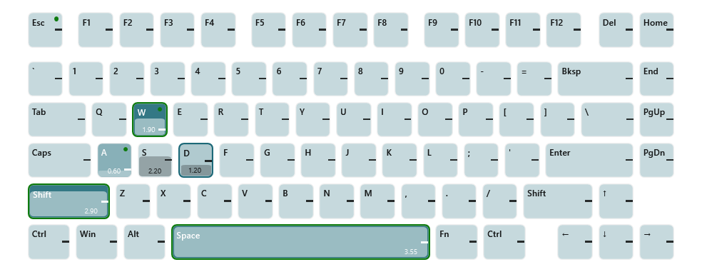

# Womier SK75 TMR driver

A small Windows tray application that replaces the vendor software for the **Womier SK75 TMR** magnetic
keyboard. It sets the actuation point and rapid trigger of every key, keeps any number of profiles, and
switches profiles automatically when a game is running.


## Features

* **Per-key actuation** – click a key, drag a rectangle or use the quick-select buttons (All, WASD, Letters,
  Numbers, F-row, Modifiers, Arrows) and set the actuation point, rapid trigger with press/release sensitivity,
  release point and bottom dead zone for the whole selection at once. The keyboard picture shows every key's
  actuation depth; sensitive keys are tinted with your accent colour, rapid-trigger keys carry a dot.
* **Live view** – switch on *Live* above the keyboard picture and press keys: every tile shows how deep the key
  is pressed right now (a bar climbing towards the profile's actuation mark) and turns green the moment Windows
  receives the key. Key presses are read only while the window is open and the toggle is on; nothing is recorded.

  
* **Profiles** – create, duplicate, rename, import/export as JSON. One profile is the *default* and is used
  whenever no game is running.
* **Game rules** – attach process names (for example `bf6.exe`) to a profile, or pick them from the list of
  running programs. While such a process runs, its profile is written to the keyboard; when it exits, the
  default profile comes back.
* **Tray driver** – runs in the background with a tray icon. Left click opens the window; right click shows a
  menu to pick a profile by hand, return to automatic switching, open the utility or exit. Closing the window
  keeps the driver running. Optional start with Windows and a toast when a game switches the profile.
* **Cable or 2.4 GHz** – talks to the keyboard itself, on its USB cable or through its 2.4 GHz receiver (it
  follows the keyboard's mode switch; with the switch on 2.4 GHz the cable only charges); no vendor processes are needed. Every write is verified by reading the
  keyboard back, and nothing is written when the keyboard already holds the settings. Over 2.4 GHz the sidebar
  shows the battery level and when the keyboard sleeps; a profile switch that happens while it sleeps is written
  as soon as you press a key.
* **Light and dark** – WPF Fluent theme following the Windows theme and accent colour.

## Requirements

* Windows 10/11 x64. The portable release needs nothing else; a framework-dependent build needs the
  [.NET 10 Desktop Runtime](https://dotnet.microsoft.com/download/dotnet/10.0).
* A Womier SK75 TMR (USB VID `0x3151`, firmware 3.x). Other RY5088-based boards are detected but ignored.
* The vendor "WOMIER Driver" can stay installed; both can even run at the same time on the cable. For
  predictable results let only one of them start with Windows, and close the vendor application while using the
  2.4 GHz receiver (both relay their commands through the receiver's single answer buffer).

## Download and run (no installation)

1. Download `WomierDriver-<version>-win-x64.zip` from the [Releases](../../releases) page.
2. Extract it anywhere, for example `C:\Tools\WomierDriver`, and start `WomierDriver.exe`. It is one
   self-contained executable: no installer and no runtime to install. The driver only writes to
   `%APPDATA%\WomierDriver` (profiles, settings, log) and, if you enable it, the autostart value in the registry.
3. Windows SmartScreen may warn because the file is not code-signed: choose *More info* → *Run anyway*.
4. Enable *Start with Windows* in the sidebar once you are happy. The autostart entry points at the folder you
   chose, so re-enable the toggle after moving the executable.

To update, replace the executable with the one from the newer release; profiles and settings stay in `%APPDATA%`.

## Build and run

```powershell
git clone <this repository>
cd womier-driver
dotnet build WomierDriver.slnx
dotnet run --project src/WomierDriver.App          # opens the window; add "-- --minimized" to start in the tray
dotnet test src/WomierDriver.Tests                 # unit tests, no hardware needed
```

Publish a folder you can copy anywhere (the app then lives wherever you put it; enable *Start with Windows*
in the sidebar to register that location):

```powershell
dotnet publish src/WomierDriver.App -c Release -r win-x64 --self-contained true -o publish    # portable single exe (what the releases ship)
dotnet publish src/WomierDriver.App -c Release -r win-x64 --self-contained false -o publish   # small, needs the .NET 10 Desktop Runtime
```

## Using it

1. On first start the driver reads the keyboard and stores those settings as the **Default** profile, and adds
   a **Gaming** preset (1.0 mm actuation, rapid trigger on) that you can adapt or delete.
2. Select keys on the picture and change the settings on the left. Changes are saved immediately and, if the
   profile is the one currently active on the keyboard, written to it right away (the status line at the
   bottom confirms "81 keys written and verified").
3. Add games under **Games** (type the process name or *Pick from running processes…*, which lists the
   programs that currently have a window). Task Manager → Details shows a game's process name if you are not sure.
4. Use **Activate on keyboard** or the tray menu to switch by hand. A manual choice lasts until a listed game
   starts or stops; *Automatic (follow games)* in the tray menu returns to rule-based switching immediately.
5. The *…* menu holds *Set as default*, *Duplicate*, *Read settings from keyboard* (copy what the keyboard holds
   into the profile), *Export* and *Delete*.
6. **Live** (above the keyboard picture) shows what the keyboard does in real time: a bar in every tile for the
   current key travel, a tick at the selected profile's actuation point (shown when that profile is the active
   one) and a green outline while Windows reports the key as pressed. Keys pressed while the window has focus are
   swallowed so nothing gets typed into the driver by accident; the toggle resets when the window closes.

Settings reference (all in millimetres of key travel, 0.01 mm steps):

| Setting | Range | Meaning |
|---|---|---|
| Actuation point | 0.10 – 3.30 | depth at which the key registers |
| Rapid trigger | on/off | re-arm and release relative to the key's movement instead of fixed points |
| RT press / release sensitivity | 0.01 – 2.00 | movement needed to (re)trigger / release while rapid trigger is on |
| Release point | 0.10 – 3.30 | reset depth used when rapid trigger is off |
| Bottom dead zone | 0.00 – 1.00 | travel near the bottom that is ignored |

Data lives in `%APPDATA%\WomierDriver` (`profiles.json`, `settings.json`, `driver.log`).

## Diagnostics

```powershell
dotnet run --project tools/HidProbe                  # list HID interfaces and identify the keyboard
dotnet run --project tools/HidProbe -- dump          # every key's current settings
dotnet run --project tools/HidProbe -- set KeyW 1.2  # write one actuation point and read it back
dotnet run --project tools/HidProbe -- watch         # plug / unplug events
dotnet run --project tools/HidProbe -- live 30       # print the keyboard's live travel reports for 30 s
dotnet run --project tools/HidProbe -- travel 10     # poll the live travel table instead, 10 s
dotnet run --project tools/HidProbe -- receiver      # 2.4 GHz receiver: keyboard awake?, battery (works while it sleeps)
dotnet run --project tools/HidProbe -- dump --trace  # over 2.4 GHz: log every receiver status while relaying
```

## How it works

The keyboard exposes a vendor HID collection that accepts 64-byte feature reports. Per-key settings are plain
tables (128 slots × u16 or u8) that are read in 64-byte chunks and written in 56-byte chunks with a commit
flag on the last one; the firmware version decides the unit (0.01 mm on current firmware). For the live view the
keyboard is switched into a reporting mode in which it streams the travel of every moving key (up to about
1 kHz) on a second HID collection, while Windows' own key events say when a key has actually triggered. Over
2.4 GHz the same commands are relayed by the receiver: the driver asks it whether the keyboard is awake, sends the
command, waits until the receiver has the answer and then fetches it. The protocol was recovered from the vendor's
Electron application and native helper and verified against the keyboard; see
[docs/protocol.md](docs/protocol.md). The structure of the code is described in
[docs/architecture.md](docs/architecture.md), and [CLAUDE.md](CLAUDE.md) has the working rules for the repo.

```
src/WomierDriver.Core    protocol, HID transport, device model, profiles, automation engine
src/WomierDriver.App     WPF tray application
src/WomierDriver.Tests   xunit tests with an in-memory fake of the keyboard firmware
tools/HidProbe           command-line diagnostics
tools/gen-layout.py      generates the key table from the vendor layout data
docs/                    protocol, architecture, reverse-engineering notes and vendor sources
```

## Scope and limitations

* Supports the SK75 TMR only (device id 2518). The layout, matrix slots and value ranges are specific to it.
* Manages the analog settings (actuation, release, rapid trigger, dead zone). Key remapping, lighting, macros,
  calibration and firmware updates remain in the vendor software; the driver never touches those tables.
* Advanced vendor key modes (DKS, mod-tap, toggle, snap tap) are reset to "normal" on keys the driver writes.
* Settings are written to the on-board profile that is active on the keyboard, the same as the vendor software.
* Top dead zone is only available on firmware 1024 and newer; the SK75 TMR ships with 776 (3.08).
* In the live view the "pressed" outline comes from Windows, so Fn (which never reaches Windows) and keys
  remapped in the vendor software do not light up as expected; the depth bar works for every key.
* Over 2.4 GHz every command travels through the receiver, so a profile switch takes about 1.7 s instead of
  1 s, and a sleeping keyboard only gets its settings after the next key press.

## Credits and license

Independent project, not affiliated with Womier. Protocol knowledge comes from reading the vendor's software
and from measurements on the author's own keyboard.
