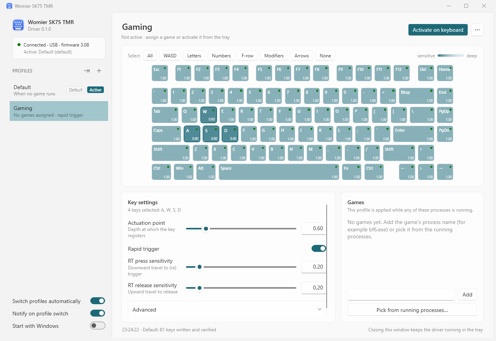

# Womier SK75 TMR driver

A small Windows tray application that replaces the vendor software for the **Womier SK75 TMR** magnetic
keyboard. It sets the actuation point and rapid trigger of every key, keeps any number of profiles, and
switches profiles automatically when a game is running.



## Features

* **Per-key actuation** – click a key, drag a rectangle or use the quick-select buttons (All, WASD, Letters,
  Numbers, F-row, Modifiers, Arrows) and set the actuation point, rapid trigger with press/release sensitivity,
  release point and bottom dead zone for the whole selection at once. The keyboard picture shows every key's
  actuation depth; sensitive keys are tinted with your accent colour, rapid-trigger keys carry a dot.
* **Profiles** – create, duplicate, rename, import/export as JSON. One profile is the *default* and is used
  whenever no game is running.
* **Game rules** – attach process names (for example `bf6.exe`) to a profile, or pick them from the list of
  running programs. While such a process runs, its profile is written to the keyboard; when it exits, the
  default profile comes back.
* **Tray driver** – runs in the background with a tray icon. Left click opens the window; right click shows a
  menu to pick a profile by hand, return to automatic switching, open the utility or exit. Closing the window
  keeps the driver running. Optional start with Windows and a toast when a game switches the profile.
* **Direct USB HID** – talks to the keyboard itself (wired first, 2.4 GHz receiver as fallback); no vendor
  processes are needed. Every write is verified by reading the keyboard back. Reconnecting the keyboard
  re-applies the active profile.
* **Light and dark** – WPF Fluent theme following the Windows theme and accent colour.

## Requirements

* Windows 10/11 x64 with the [.NET 10 Desktop Runtime](https://dotnet.microsoft.com/download/dotnet/10.0)
  (or publish self-contained, see below).
* A Womier SK75 TMR (USB VID `0x3151`, firmware 3.x). Other RY5088-based boards are detected but ignored.
* The vendor "WOMIER Driver" can stay installed; both can even run at the same time. For predictable results
  let only one of them start with Windows.

## Build and run

```powershell
git clone <this repository>
cd womier-driver
dotnet build WomierDriver.slnx
dotnet run --project src/WomierDriver.App          # opens the window; add "-- --minimized" to start in the tray
dotnet test src/WomierDriver.Tests                 # unit tests, no hardware needed
```

Publish a folder you can copy anywhere (the app then lives wherever you put it; enable *Start with Windows*
in the sidebar to register that location):

```powershell
dotnet publish src/WomierDriver.App -c Release -r win-x64 --self-contained false -o publish
# or, without a runtime dependency (bigger):
dotnet publish src/WomierDriver.App -c Release -r win-x64 --self-contained true -p:PublishSingleFile=true -o publish
```

## Using it

1. On first start the driver reads the keyboard and stores those settings as the **Default** profile, and adds
   a **Gaming** preset (1.0 mm actuation, rapid trigger on) that you can adapt or delete.
2. Select keys on the picture and change the settings on the left. Changes are saved immediately and, if the
   profile is the one currently active on the keyboard, written to it right away (the status line at the
   bottom confirms "81 keys written and verified").
3. Add games under **Games** (type the process name or *Pick from running processes…*, which lists the
   programs that currently have a window). Task Manager → Details shows a game's process name if you are not sure.
4. Use **Activate on keyboard** or the tray menu to switch by hand. A manual choice lasts until a listed game
   starts or stops; *Automatic (follow games)* in the tray menu returns to rule-based switching immediately.
5. The *…* menu holds *Set as default*, *Duplicate*, *Read settings from keyboard* (copy what the keyboard holds
   into the profile), *Export* and *Delete*.

Settings reference (all in millimetres of key travel, 0.01 mm steps):

| Setting | Range | Meaning |
|---|---|---|
| Actuation point | 0.10 – 3.30 | depth at which the key registers |
| Rapid trigger | on/off | re-arm and release relative to the key's movement instead of fixed points |
| RT press / release sensitivity | 0.01 – 2.00 | movement needed to (re)trigger / release while rapid trigger is on |
| Release point | 0.10 – 3.30 | reset depth used when rapid trigger is off |
| Bottom dead zone | 0.00 – 1.00 | travel near the bottom that is ignored |

Data lives in `%APPDATA%\WomierDriver` (`profiles.json`, `settings.json`, `driver.log`).

## Diagnostics

```powershell
dotnet run --project tools/HidProbe                  # list HID interfaces and identify the keyboard
dotnet run --project tools/HidProbe -- dump          # every key's current settings
dotnet run --project tools/HidProbe -- set KeyW 1.2  # write one actuation point and read it back
dotnet run --project tools/HidProbe -- watch         # plug / unplug events
```

## How it works

The keyboard exposes a vendor HID collection that accepts 64-byte feature reports. Per-key settings are plain
tables (128 slots × u16 or u8) that are read in 64-byte chunks and written in 56-byte chunks with a commit
flag on the last one; the firmware version decides the unit (0.01 mm on current firmware). The protocol was
recovered from the vendor's Electron application and verified against the keyboard; see
[docs/protocol.md](docs/protocol.md). The structure of the code is described in
[docs/architecture.md](docs/architecture.md), and [CLAUDE.md](CLAUDE.md) has the working rules for the repo.

```
src/WomierDriver.Core    protocol, HID transport, device model, profiles, automation engine
src/WomierDriver.App     WPF tray application
src/WomierDriver.Tests   xunit tests with an in-memory fake of the keyboard firmware
tools/HidProbe           command-line diagnostics
tools/gen-layout.py      generates the key table from the vendor layout data
docs/                    protocol, architecture, reverse-engineering notes and vendor sources
```

## Scope and limitations

* Supports the SK75 TMR only (device id 2518). The layout, matrix slots and value ranges are specific to it.
* Manages the analog settings (actuation, release, rapid trigger, dead zone). Key remapping, lighting, macros,
  calibration and firmware updates remain in the vendor software; the driver never touches those tables.
* Advanced vendor key modes (DKS, mod-tap, toggle, snap tap) are reset to "normal" on keys the driver writes.
* Settings are written to the on-board profile that is active on the keyboard, the same as the vendor software.
* Top dead zone is only available on firmware 1024 and newer; the SK75 TMR ships with 776 (3.08).
* The 2.4 GHz receiver path is implemented but has only been verified with the keyboard on its cable.

## Credits and license

Independent project, not affiliated with Womier. Protocol knowledge comes from reading the vendor's software
and from measurements on the author's own keyboard. Private repository; all rights reserved.
